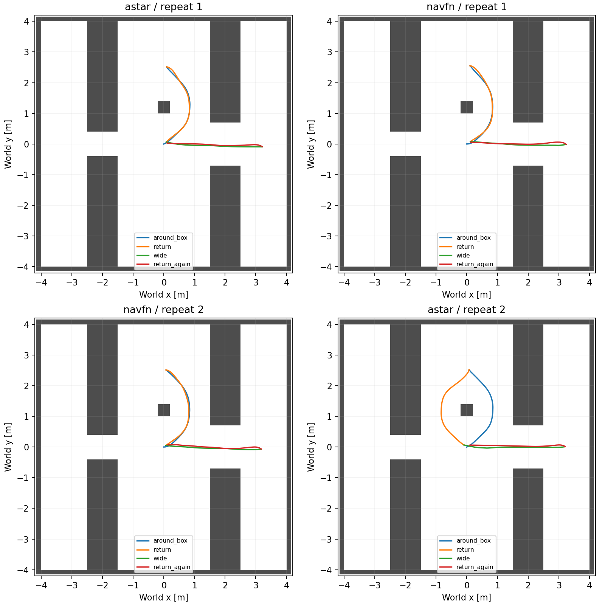

# ros2-nav2-diffbot

ROS 2 Humble / Nav2 差速移动机器人仿真项目，包含自建模型、SLAM 建图、AMCL 定位、绕障导航、自研 A* 全局规划插件，以及 NavFn 对照评测。



Ubuntu 22.04、ROS 2 Humble、Gazebo Fortress 仿真项目。已完成自建差速小车、建图定位、Nav2 导航和自研 A* 全局规划插件，M8 汇总评测并整理交付。

## 从哪里开始

- 阶段总览与交付：[M8 评测与项目交付](docs/ROS2-Nav2-M8评测与项目交付.md)。
- 算法实现：[M7 自研 A* 说明](docs/ROS2-Nav2-M7自研AStar规划器与验收.md)。
- 当前配置验收：[校准配置回归与规划器对照](docs/ROS2-Nav2-M7校准配置回归与规划器对照.md)。
- 可重新生成的结果：`artifacts/m8/evaluation/`。

Windows 中的本目录存放源码、文档和证据；真正运行 ROS 的工作空间为 Ubuntu `~/nav_ws`。SSH 密钥属于个人连接配置，不是项目运行依赖，也不在交付包中。

## 在现有 Ubuntu 上运行演示

先结束已有仿真，只保留一套系统。终端 A：

```bash
source /opt/ros/humble/setup.bash
source ~/nav_ws/install/setup.bash
ros2 run my_robot_navigation start_calibrated_navigation.sh gui:=true
```

会打开 Gazebo 和 RViz，初始小车静止。地图与模型显示正常、导航节点激活后，终端 B 依次执行，前一个成功再执行下一个：

```bash
source /opt/ros/humble/setup.bash
source ~/nav_ws/install/setup.bash
ros2 run my_robot_navigation start_safe_navigation.sh 0 2.6
ros2 run my_robot_navigation start_safe_navigation.sh 0 0
```

第一段绕过中间箱体，第二段返回。`start_safe_navigation.sh` 使用带预检和额外间距的任务入口；RViz 的普通 Nav2 Goal 不等同于该入口。请勿同时发送手动目标或键盘遥控。停止任务测试后，在终端 A 按 Ctrl+C 结束仿真。

默认使用软件渲染。VMware 中同时显示两个 GUI 会增加负载；自动实验通常使用 `gui:=false rviz:=false`。

## 新环境准备与编译

以下步骤仅用于新工作空间，不覆盖已有 `~/nav_ws` 或 `~/tf_fix_ws`。实际环境版本与补丁见 `artifacts/m8/support/` 和 M8 文档；本项目没有承诺任意未来系统包版本均兼容。

1. 准备 Ubuntu 22.04、ROS 2 Humble 及其软件源。安装 ROS/Gazebo 和构建依赖（需要系统管理权限）：

```bash
sudo apt update
sudo apt install ros-humble-ros-gz ros-humble-navigation2 ros-humble-nav2-bringup \
  ros-humble-nav2-rotation-shim-controller ros-humble-slam-toolbox \
  ros-humble-rmw-cyclonedds-cpp python3-colcon-common-extensions \
  python3-rosdep python3-numpy python3-yaml python3-matplotlib
```

2. 在尚不存在 `~/nav_ws` 的新环境中克隆：

```bash
git clone https://github.com/haodiGeng/ros2-nav2-diffbot.git ~/nav_ws
```

也可以将完整交付包解压到 `~/nav_ws`，使源码位于 `~/nav_ws/src`。在未初始化 rosdep 的新系统执行 `sudo rosdep init`，之后执行 `rosdep update`。
3. 建立独立 tf2 覆盖工作空间。源码快照已经带补丁，不要再重复打补丁：

```bash
mkdir -p ~/tf_fix_ws/src
tar -xzf ~/nav_ws/artifacts/m8/support/geometry2-patched-source.tar.gz -C ~/tf_fix_ws/src
source /opt/ros/humble/setup.bash
cd ~/tf_fix_ws
rosdep install --from-paths src --ignore-src -r -y --rosdistro humble
colcon build --packages-select tf2 --cmake-args -DBUILD_TESTING=OFF
```

4. 编译项目四个包：

```bash
source /opt/ros/humble/setup.bash
source ~/tf_fix_ws/install/setup.bash
cd ~/nav_ws
rosdep install --from-paths src --ignore-src -r -y --rosdistro humble
colcon build --symlink-install
source ~/nav_ws/install/setup.bash
source ~/tf_fix_ws/install/setup.bash
colcon test --packages-select my_planner
colcon test-result --verbose
```

覆盖库的来源、补丁和 BSD 许可证随交付保存。新环境全流程仍需按本机依赖状态执行，交付验收记录明确区分同虚拟机独立构建与全新虚拟机验证。

## 重新生成评测

无需启动 ROS 或移动小车。Ubuntu 中：

```bash
cd ~/nav_ws
python3 tools/evaluate_project.py
```

Windows PowerShell 中也可生成 JSON、CSV、Markdown（不要求安装绘图库）：

```powershell
python tools/evaluate_project.py --no-plots
```

脚本从存档重新计算指标并核查关键断言，不是新做了 105 次规划或 16 次导航。新导航实验复现步骤见 M7 专项文档；这些实验会实际驱动仿真小车，部分旧脚本会覆盖同名结果，应先归档。

## 打包与验证

```bash
python3 tools/build_delivery.py
python3 tools/verify_delivery.py artifacts/m8/delivery/ros2_nav2_m8_delivery.zip
```

输出 ZIP、SHA-256 和逐文件清单。验证脚本可使用 `--extract-to 新目录` 校验并解压，目标目录必须尚不存在。

项目包：`my_robot_description`（模型）、`my_robot_gazebo`（物理与桥接）、`my_robot_navigation`（配置与启动）、`my_planner`（A* 内核与 Nav2 插件）。历史 M2 使用 BCR Bot，当前自建小车与其不是同一套模型配置。

当前验收限于已记录的静态仿真场景。动态障碍、实物迁移、精确停靠和大样本性能优势均未验收。

## 许可证与发布材料

本项目 ROS 包声明采用 Apache-2.0，完整条款见 [LICENSE](LICENSE)。第三方组件及 tf2 支持源码保留各自许可证，见 [THIRD_PARTY_NOTICES.md](THIRD_PARTY_NOTICES.md)。

源码仓库保留代码、配置、阶段说明与评测证据；运行日志和自动生成的交付 ZIP 不纳入 Git 历史。完整交付包及其 SHA-256 见 [GitHub Releases](https://github.com/haodiGeng/ros2-nav2-diffbot/releases)，仓库内也可用打包脚本重新生成。使用中遇到问题可在 [Issues](https://github.com/haodiGeng/ros2-nav2-diffbot/issues) 提供环境、启动命令和报错。
