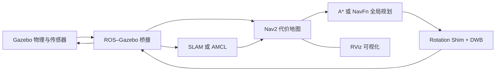

# ros2-nav2-diffbot

ROS 2 Humble / Nav2 差速移动机器人仿真项目，包含自建模型、SLAM 建图、AMCL 定位、路径规划和运动控制，并实现可配置的 A* 全局规划插件，用于研究栅格连通性、对角切角规则和离障代价对导航行为的影响。

适用于 ROS 2 导航学习、全局规划算法实验和静态场景中的导航方案验证。

## 主要功能

- **差速机器人仿真**：底盘、轮组、激光雷达、轮式里程计和 ROS–Gazebo 话题桥接。
- **建图与定位**：使用 SLAM Toolbox 构建地图，使用 AMCL 在已有地图中定位。
- **导航控制**：接入 Nav2，使用 Rotation Shim 与 DWB 执行路径跟踪和转向。
- **自研 A* 插件**：支持 4/8 连通、禁止对角切角、栅格代价权重、未知区域策略和可选额外净间距。
- **任务预检**：检查机器人空闲状态与目标可达性，在路径不满足间距约束时拒绝启动导航。

## 系统架构



| ROS 包 | 职责 |
|---|---|
| `my_robot_description` | URDF/Xacro 模型与传感器安装关系 |
| `my_robot_gazebo` | 仿真世界、差速驱动、传感器及话题桥接 |
| `my_robot_navigation` | 建图、定位、导航配置与任务入口 |
| `my_planner` | A* 搜索内核、Nav2 插件和单元测试 |

## 环境与安装

| 组件 | 已验证环境 |
|---|---|
| 操作系统 | Ubuntu 22.04 |
| ROS 2 | Humble |
| 仿真器 | Gazebo Fortress 6.18.0 |
| 导航框架 | Nav2 1.1.20 |
| DDS 实现 | Cyclone DDS |

项目使用独立的 tf2 修复覆盖库，其源码、补丁及许可证随仓库提供。依赖安装、覆盖库构建和项目编译见 **[安装指南](docs/installation.md)**。

## 运行导航演示

完成安装后，在 Ubuntu 终端启动演示：

```bash
source /opt/ros/humble/setup.bash
source ~/nav_ws/install/setup.bash
ros2 run my_robot_navigation start_calibrated_navigation.sh gui:=true
```

该入口加载示例地图和仿真校准参数，打开 Gazebo 与 RViz。导航系统激活后，在另一个终端发送目标：

```bash
source /opt/ros/humble/setup.bash
source ~/nav_ws/install/setup.bash
ros2 run my_robot_navigation start_safe_navigation.sh 0 2.6
```

机器人绕过示例场景中的箱体前往目标。任务成功后，可发送返回目标：

```bash
ros2 run my_robot_navigation start_safe_navigation.sh 0 0
```

同一时刻只运行一套仿真和一个运动指令来源。建图、无 GUI 运行、任务状态与停止方法见 **[使用指南](docs/usage.md)**。

## 评测结果

固定地图测试包含 3 组起终点、7 种规划配置，每组配置预热后测量 5 次，共 105 个测量请求。闭环导航对照中，自研 A* 与 NavFn 各运行两轮四目标序列，共 16 次导航，均成功且未触发恢复。


*图中为同一静态场景下的实际世界坐标轨迹，每种规划器重复两轮。*

现有实验中，两种规划器的导航耗时和行驶距离接近；固定地图测试也未证明自研 A* 更快。自研实现主要提供可独立控制的搜索规则和代价参数。测试条件、指标定义、完整结果及复现命令见 **[评测说明](docs/evaluation.md)**。

```bash
cd ~/nav_ws
python3 tools/evaluate_project.py
```

该命令从归档数据重新生成表格和图表，输出至 `results/evaluation/`，不会启动机器人。

## 文档与目录

- [安装指南](docs/installation.md)：依赖安装与构建。
- [使用指南](docs/usage.md)：建图、导航、任务预检与停止操作。
- [A* 规划器](docs/planner.md)：算法、接口、参数与约束。
- [评测说明](docs/evaluation.md)：实验条件、指标及复现方式。
- [常见问题](docs/troubleshooting.md)：GUI、传感器、定位与环境排查。

```text
src/        ROS 包源码、配置、模型与地图
docs/       使用文档与归档开发记录
tools/      评测、打包和完整性检查工具
support/    依赖补丁、第三方源码与环境记录
results/    汇总表与图表
artifacts/  原始实验数据与历史证据
```

## 适用范围

已记录的验证覆盖静态仿真场景中的建图、定位、绕障和连续目标任务。动态障碍、真实硬件迁移、精确停靠和长时间稳定性尚未验收。示例仿真校准参数需要根据模型与传感器条件重新调整。

当前复现检查是在同一 Ubuntu 虚拟机中独立解压、编译并运行完成，未覆盖全新系统从零安装。

## 许可证与反馈

项目采用 [Apache-2.0](LICENSE)。第三方组件及 tf2 修复源码保留各自许可证，详见 [第三方说明](THIRD_PARTY_NOTICES.md)。

完整发布包见 [Releases](https://github.com/haodiGeng/ros2-nav2-diffbot/releases)。使用问题或改进建议可通过 [Issues](https://github.com/haodiGeng/ros2-nav2-diffbot/issues) 提交，并附环境版本、启动命令和相关日志。
