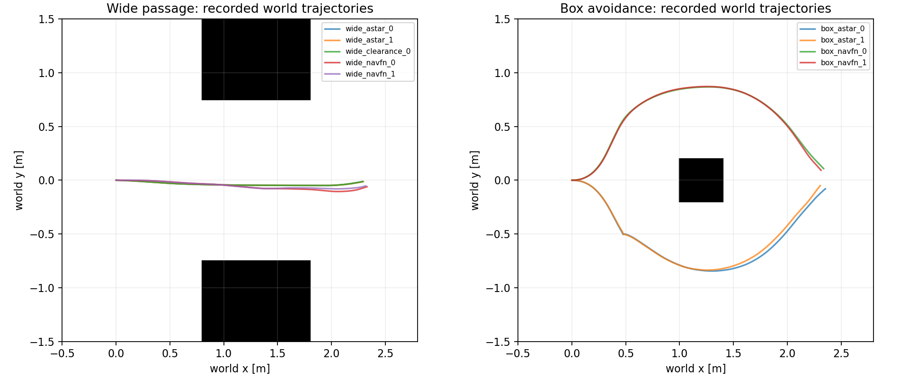

# M7 实际行驶场景验收与待修问题

2026-11-23，完成 11 次独立启动的实际 Gazebo 测试，包括 10 次导航行驶和 1 次拒绝规划后的静止观察。**宽通道通过稳定跟踪检查；自研 A* 在矩形障碍前重复出现停滞，普通窄通道也触发恢复，因此尚不能宣称针对性场景的稳定导航全部验收通过。**

## 1. 场景与条件

新增 `world_file` 启动参数，将测试世界传入现有仿真。未指定时仍使用原 training.sdf，不改变 M6/M7 默认入口。每次测试独立启动一套 domain25、my_robot_m4 仿真，关闭 GUI 和 RViz，使用相同 AMCL、DWB、速度限制与目标容差。

所有测试从 (0,0,0) 前往 (2.4,0,0)。每轮只测试一个目标，不在运动中重置定位。由同一组障碍矩形生成 SDF 和分析地图：0.05 m 分辨率、128×128、原点 (-3.2,-3.2)，外墙内侧在 ±3.0 m。map/world 按场景构造对齐，不用世界真值控制或修正机器人。

- 宽通道：x=0.8～1.8 m 处形成 1.50 m 开口；A* 与 NavFn 各两轮，另测一次开启额外 0.15 m 间隙的 A*。
- 矩形障碍：中心 (1.2,0)，平面尺寸 0.4×0.4 m；A* 与 NavFn 各两轮。
- 窄通道：开口 0.80 m；普通 A* 行驶一次，额外 0.15 m 间隙配置做一次拒绝检查。

普通自研配置为 8 邻接、cost_weight=2、额外间隙关闭；NavFn 使用 Dijkstra、tolerance=0、拒绝未知。机器人代价地图半径 0.35 m，膨胀半径 0.65 m；除规划插件/间隙参数外，两种配置一致。重复次数只有两次，能说明本次复现情况，不构成统计性能排名。

## 2. 实测结果

| 测试 | 状态 | 恢复次数 | 耗时 s | 最小采样车体间距 m | 同时间 AMCL/world 最大位置差 m |
|---|---|---:|---:|---:|---:|
| 宽通道 A* 第 1 轮 | 成功 | 0 | 15.03 | 0.481 | 0.016 |
| 宽通道 A* 第 2 轮 | 成功 | 0 | 15.16 | 0.481 | 0.016 |
| 宽通道 NavFn 第 1 轮 | 成功 | 0 | 16.13 | 0.442 | 0.013 |
| 宽通道 NavFn 第 2 轮 | 成功 | 0 | 15.57 | 0.450 | 0.014 |
| 宽通道 A* 硬间隙模式 | 成功 | 0 | 15.12 | 0.481 | 0.016 |
| 矩形障碍 A* 第 1 轮 | 成功 | 5 | 89.45 | 0.296 | 0.021 |
| 矩形障碍 A* 第 2 轮 | 成功 | 5 | 88.58 | 0.299 | 0.048 |
| 矩形障碍 NavFn 第 1 轮 | 成功 | 0 | 21.77 | 0.402 | 0.030 |
| 矩形障碍 NavFn 第 2 轮 | 成功 | 0 | 21.32 | 0.404 | 0.036 |
| 窄通道普通 A* | 成功 | 5 | 20.93 | 0.034 | 0.018 |
| 窄通道硬间隙模式 | 拒绝规划 | 0 | 0.0066（规划请求） | 静止观察，不用于行驶比较 | 无同时间配对 |

拒绝实验返回 ABORTED=6、0 个路径点，随后观察约 5 秒，世界位置最大平移为 0，非零速度命令数为 0。该测试调用 ComputePathToPose，未发送 NavigateToPose；它验证“预规划拒绝后不下发运动”的调用流程。**不能据此声称默认导航行为树在规划失败时绝不会执行旋转或后退恢复。** 若业务要求拒绝后始终静止，需要在任务入口保留预规划门控或专门配置失败行为。

10 次实际行驶均最终返回 SUCCEEDED=4，全部轨迹采样未发现车体与场景障碍重叠。窄通道 0.034 m 余量很小，加上触发恢复，不能将这一结果作为稳定或安全推荐。



## 3. 已定位到的异常范围

矩形障碍的两轮 A* 均在约 (0.48,-0.50) 停滞。首轮在运动开始约 15～60 秒的真值位置基本不变，之后经恢复继续行驶。服务端日志出现 Failed to make progress。第二轮重复发生同类现象，耗时约 89 秒。

在第二轮仿真时间约 55.5～76.6 秒，独立订阅 `/plan` 得到 21 条路径，始终从障碍下方通过，最小 y 约 -0.87，没有观察到两侧路线切换。记录保存在 `live_path_diagnostic.json`。这只能排除该观察窗口内的路线切换，不能覆盖全部运行时间。

停滞期间采样车体间距仍为正，同时间定位误差较小，因此现有证据不支持将其直接归因于发生实体碰撞或 0.27 m 量级的位置漂移。优先排查自研栅格折线与 DWB 的路径/朝向评分、可用速度采样之间的耦合；**具体根因尚未确认，未通过放宽碰撞检查或进度阈值掩盖问题。** NavFn 在当前对照中从上侧绕行，不能认为两者跟踪的是同一条几何路径。

下一项修复应先采集卡顿处的 DWB 轨迹评分、局部代价地图及速度，再评估去掉多余折点或其他经过碰撞检查的路径处理；任何修改需重新检查禁止切角和硬间隙规则，不能直接使用未经验证的平滑。

## 4. 定位误差的解释

本轮已知几何地图的行驶中，同时间 AMCL/world 最大配对位置差约 0.048 m、最大朝向差约 0.04 rad。配对要求时间戳差不超过 0.15 秒，完整数值见 summary.json。

这与“最终世界位置距目标”是不同指标。最终世界位置距目标约 0.092～0.126 m，受 0.12 m 导航位置容差、定位误差和结果之后的采样影响。停止后 AMCL 不一定继续更新，不能将最后一条较旧的 AMCL 与最终真值直接相减冒充同时间误差。

此前约 0.27 m 差值来自旧 M5 地图和连续三个目标；本轮更换为已知几何地图且每轮只跑一个目标，因此不能宣称旧问题已修复或已证明仅由旧地图导致。仍需在旧连续任务中分别控制地图、初始化与运动累积条件，才能定位旧漂移原因。

## 5. 几何测量与验收标记

使用 `/ground_truth` 的世界姿态，在每个采样点投影车体矩形、完整轮组矩形包络及支撑轮保守方形包络，与场景所有障碍矩形计算 SAT 重叠和边缘距离。车体中心偏置 -0.04 m、尺寸 0.45×0.35 m、轮组中心 y=±0.2 m，与当前 simulation=true 模型一致。这些是地面投影的离散采样检查，不是 Gazebo 接触传感器结果，也不是连续时间碰撞证明。

原始 trial.json/suite.json 中 passed 仅表示 action 返回预期状态（拒绝实验另检查静止），并不表示无恢复。summary.json 额外给出 sampled_geometry_passed 与 stable_following_passed：后者要求成功、0 次恢复和0次采样重叠；拒绝实验此字段为 null。按这个稳定跟踪条件，A* 两轮矩形绕障和普通窄通道未通过。

## 6. 文件与复现

源码：

- `physical_scenario_suite.py`：生成配套世界/地图/配置，逐轮启动并关闭仿真。
- `physical_scenario_trial.py`：记录真值、里程计、AMCL、速度命令和 action 反馈。
- `summarize_physical_scenarios.py`：生成几何、配对定位诊断、表格和轨迹图。

入口位于 `~/nav_ws/src/my_robot_navigation/scripts/`，原始结果在 `~/nav_ws/artifacts/m7_physical/`，已同步到 Windows 项目同名 artifacts 目录。每个用例目录包含 world.sdf、map.yaml/pgm、params.yaml、geometry.json、trial.json 和 navigation.log。

在没有其他自建仿真运行时，Ubuntu 终端执行：

```bash
source /opt/ros/humble/setup.bash
source ~/nav_ws/install/setup.bash
source ~/tf_fix_ws/install/setup.bash
python3 ~/nav_ws/src/my_robot_navigation/scripts/physical_scenario_suite.py
python3 ~/nav_ws/src/my_robot_navigation/scripts/summarize_physical_scenarios.py
```

不加参数会重新运行并覆盖同名用例，请先备份。`--resume` 根据 suite.json 跳过已返回预期状态的用例，并非重新验证稳定性。仿真入口停止后，脚本关闭该轮启动的进程；本轮结束后没有保留自动导航任务。

例如手动查看已有宽通道（仅启动新仿真，不自动发送目标）：

```bash
case_dir=$HOME/nav_ws/artifacts/m7_physical/wide_astar_0
bash ~/nav_ws/src/my_robot_navigation/scripts/start_navigation.sh \
  gui:=true rviz:=true world_file:=$case_dir/world.sdf \
  map:=$case_dir/map.yaml params_file:=$case_dir/params.yaml
```

本轮没有修改自研规划内核、DWB 参数或原 M6 默认配置。修复稳定跟踪问题之前，保留 NavFn 作为已验证的对照入口。

## 后续修复记录

本文件保留修复前证据。后续已完成 [跟踪卡顿排查与修复](ROS2-Nav2-M7跟踪卡顿排查与修复.md)：M7 将 DWB forward_prune_distance 设为 0.6 m 后，矩形绕障两轮均零恢复；普通窄通道仍未稳定通过。当前参数应以新说明和源码为准。
