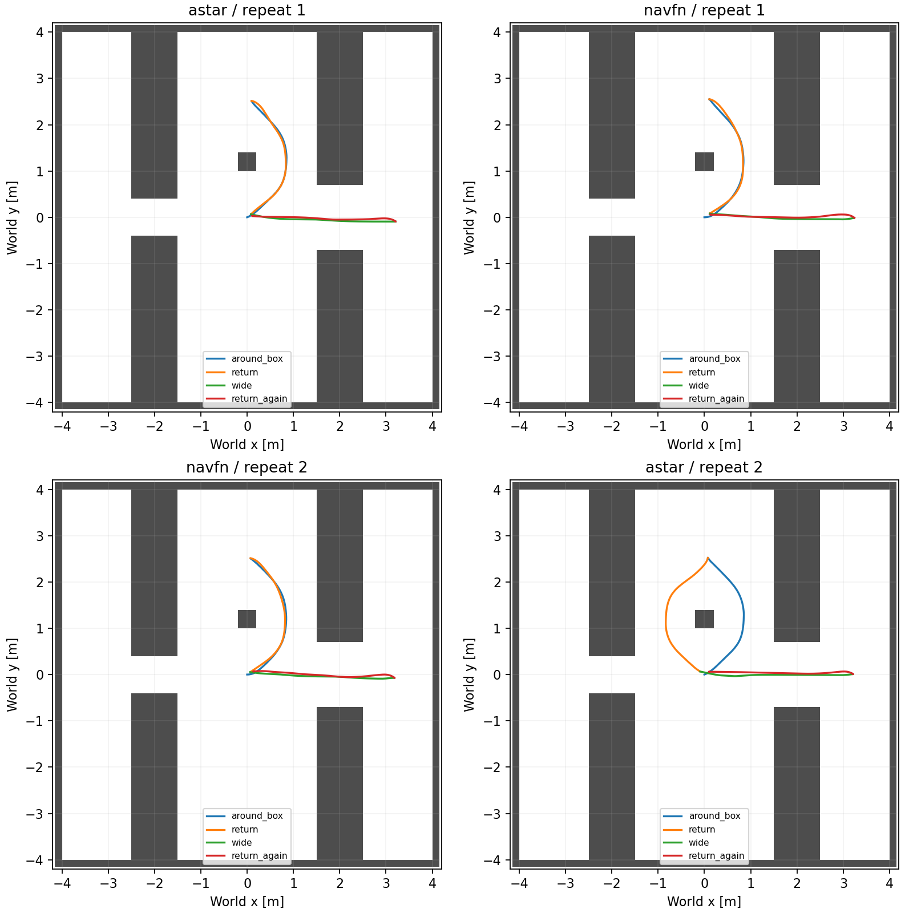

# M7 校准配置回归与规划器对照

## 验收范围

本轮在解析地图演示场景中，验证有效轮距比例 0.995、AMCL alpha1～alpha4=0.001 与既有 Rotation Shim+DWB、A*、任务门控组合后的行为。原 M6 默认配置和 A* 核心保留。

生产门控回归与算法对照分开进行，避免将不同安全策略的结果解释为算法本身的优劣。

## 连续任务回归

六步依次为绕箱至 (0, 2.6)、返回原点、宽通道至 (3.3, 0)、反向返回原点、请求窄通道至 (-3.3, 0)、拒绝后前往 (0, -0.8)。

生产 ClearanceGate 使用额外 0.15 m 间距与独立无恢复行为树。期望五次导航成功、一次在发送运动目标前被拒绝，恢复次数为零。每轮独立启动仿真，轮内不重置定位。

记录目录：`artifacts/m7_calibrated_regression1/`、`artifacts/m7_calibrated_regression2/`。

两轮均通过预期状态序列 `[成功, 成功, 成功, 成功, 预检拒绝, 成功]`，共 10 次导航成功、2 次预检拒绝，零恢复。基于真值采样和半径 0.35 m 圆计算，两轮最小障碍间距分别约 0.265 m、0.263 m，未发现采样圆重叠。

## A* 与 NavFn 对照方法

采用 A* → NavFn → NavFn → A* 顺序，各两轮，每轮重新启动仿真。每轮四个连续目标为 (0, 2.6)、(0, 0)、(3.3, 0)、(0, 0)。地图、障碍、运动模型、轮距校准、AMCL、控制器、目标容差和无恢复行为树一致；仅切换当前规划器插件及其算法参数。

两种算法均使用基础代价地图安全约束，不叠加额外净间距。为了复用行为树，实验 YAML 中的 `ClearanceGate` 别名分别指向普通 A*（extra_clearance=0）或 NavFn；这些 YAML 只用于对照，不能作为生产门控策略使用。脚本检查其余完整配置相同。

记录实际真值轨迹、初始计划长度、仿真任务时间、真实到点误差、保守半径 0.35 m 圆的采样障碍间距。任务时间包含规划、转向、执行和目标切换开销，不代表规划器 CPU 耗时。独立的固定地图规划耗时实验仍以既有 M7 基准为准。

复现前结束已有演示仿真，然后执行：

```bash
source /opt/ros/humble/setup.bash
source ~/nav_ws/install/setup.bash
source ~/tf_fix_ws/install/setup.bash
python3 ~/nav_ws/src/my_robot_navigation/scripts/calibrated_planner_comparison.py
```

对照脚本拒绝覆盖已有同名原始记录。正式重跑时应先归档旧证据，或修改独立实验标识。

## 规划器对照结果

| 算法 / 轮次 | 成功目标 | 恢复次数 | 总仿真时间 / s | 实际行驶 / m | 最大真实到点误差 / m | 最小采样圆间距 / m |
|---|---:|---:|---:|---:|---:|---:|
| A* / 1 | 4/4 | 0 | 106.06 | 12.39 | 0.130 | 0.259 |
| NavFn / 1 | 4/4 | 0 | 106.82 | 12.49 | 0.139 | 0.268 |
| NavFn / 2 | 4/4 | 0 | 105.08 | 12.41 | 0.147 | 0.237 |
| A* / 2 | 4/4 | 0 | 107.58 | 12.69 | 0.114 | 0.252 |

本场景两者表现接近，没有显示自研 A* 在导航耗时或实际行驶距离上的明显优势。自研实现的意义仍在于连通性、切角规则和代价权重可控，而不是承诺所有地图都优于 NavFn。运行中代价地图随各自传感器观测更新，本实验没有冻结其每一帧；严格固定地图查询的基准与本闭环实验是两类证据。

原始对照见 `artifacts/m7_calibrated_comparison/report.json`；实验配置和每轮日志同目录保存。完整真值、TF 和计划记录位于 `artifacts/m7_localization/compare_*_loop/record.json`。



## 检查与可视演示

新增脚本通过 Python 语法检查；缺失参数文件在启动仿真之前报错退出。哈希检查确认 A* 核心、M6 默认配置和旧训练地图 PGM 保持原样，详见 `input_checks.json` 和 `acceptance_summary.json`。导航包已重新编译。

Ubuntu 桌面已打开 Gazebo 和 RViz，用户确认两个界面显示正常。可视演示的绕障、返回两目标均成功，零恢复，`desktop_trial.json` 中 completed=true；到点后补测停止状态。实际 AMCL 参数与节点 active 状态保存在 `runtime_check.json`。演示结束时保留窗口和静止仿真，未继续发送任务。

## 本轮收尾结论

当前静态解析场景下的 M7 收尾验收通过：生产门控连续任务、两种规划器同条件闭环对照和 GUI 绕障返回均满足本轮预期。源码快照为 `source_snapshot.tar.gz`，汇总为 `acceptance_summary.json`。这项结论只适用于本文件的配置、地图、任务序列和有限重复次数，以下边界继续保留。

## 限制

每种算法只有两次重复，AMCL 和闭环轨迹存在随机差异，不能据此证明统计优势。采样圆间距不能替代连续碰撞证明。真实到点误差包含定位误差和导航容差，仍不构成精确停靠能力。

本轮不覆盖动态障碍、真实硬件、旧 M5 地图和所有窄通道。GUI 可视确认与无 GUI 自动回归分别记录。
