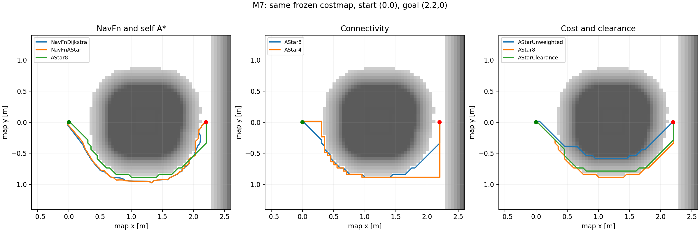
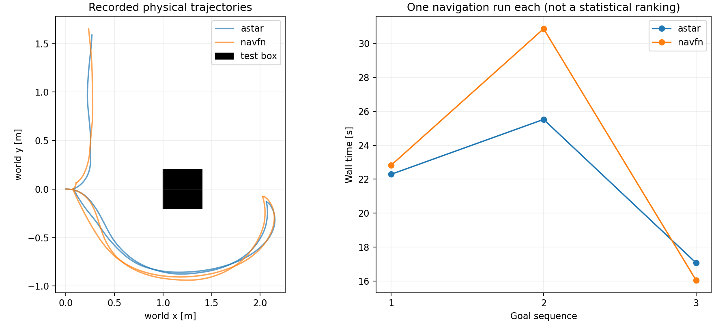

# ROS 2 Nav2 项目 M7 自研 A* 全局规划器与验收

截至 2026-11-24，M7 已按当前静态仿真范围完成。本文件作为阶段总说明，涵盖实现原理、参数、初版验收和后续专项文档索引。最终收尾结果：两轮六步门控回归通过（共 10 次导航成功、2 次预检拒绝）；A* 与 NavFn 各两轮四目标对照共 16 次导航成功；GUI 绕障与返回两目标成功。以上导航均零恢复。最新数据与测试边界见 [校准配置回归与规划器对照](ROS2-Nav2-M7校准配置回归与规划器对照.md)。

以下初版实现和基准数据保留其原始测试条件，不应与后续配置的结果混为同一轮实验。

2026-11-23，完成 `my_planner/AStarPlanner` 第一版：Ubuntu 编译、14 个内核测试、固定地图 7 种规划配置对比、自建小车三目标连续导航均已通过。初版 A* 和 NavFn 的实际导航对照均为 3/3 成功、0 次恢复。源码、配置、原始轨迹和图表已同步到 Windows 项目。

本阶段实现的是可控、可解释的实验规划器。测试没有证明 A* 普遍优于 NavFn，也没有证明 NavFn 在当前地图中存在碰撞问题。当前验收覆盖简单静态仿真，不等于实物安全或复杂场景验收。M6 默认入口仍保留 NavFn+DWB，M7 使用独立入口。

## 1. 本阶段解决什么

| 目标 | 实现 | 验收依据 |
|---|---|---|
| 控制网格连通性 | 4 邻接或 8 邻接 | 空地图代价、随机地图与独立 Dijkstra 对照、同图路径比较 |
| 明确禁止对角切角 | 对角移动要求两个正交邻格也可通行；所有返回线段再次做 supercover 检查 | 对角夹缝测试、随机路径逐段检查 |
| 调整离障偏好 | 距离乘以非负栅格代价权重 | 同图比较 weight=0、2、8 |
| 独立设置额外净间隙 | 可选欧氏距离场，按机器人外接圆加额外距离筛格 | 窄通道、距离场与暴力计算对照、不重复把膨胀区当实体障碍 |
| 接入现有导航闭环 | Humble GlobalPlanner 插件，DWB 跟踪，AMCL 定位 | 三目标连续导航；实际参数证据 |

“障碍惩罚权重”是软偏好，不保证固定离墙距离；额外净间隙是单独的硬约束。NavFn 自身也能受代价地图膨胀参数影响，不能将它描述成完全不能调整离障距离。

## 2. 文件与接口

| 文件 | 作用 |
|---|---|
| `src/my_planner/include/my_planner/astar_core.hpp` | 与 ROS 无关的网格、选项、结果接口 |
| `src/my_planner/src/astar_core.cpp` | A*、距离场、线段检查 |
| `src/my_planner/src/astar_planner.cpp` | Nav2 插件适配、地图快照、路径和统计发布 |
| `src/my_planner/astar_planner_plugin.xml` | pluginlib 注册 |
| `src/my_planner/test/test_astar_core.cpp` | 14 个 gtest |
| `src/my_robot_navigation/config/nav2_astar_params.yaml` | M7 导航配置：自研 A* + DWB |
| `src/my_robot_navigation/config/nav2_navfn_comparison.yaml` | 仅将主规划插件换为 NavFn 的导航对照 |
| `src/my_robot_navigation/config/planner_benchmark.yaml` | 固定地图 7 种配置 |
| `src/my_robot_navigation/scripts/start_astar_navigation.sh` | M7 一键入口 |
| `src/my_robot_navigation/scripts/benchmark_planners.py` | 固定地图规划对比及非法目标验收 |
| `artifacts/m7/` | 原始数据、日志、图表、测试 XML |

工作空间为 Ubuntu `/home/geng/nav_ws`。实际运行参数已核查 `GridBased.plugin = my_planner/AStarPlanner`；`runtime_evidence.txt` 记录 `/tf` 的三个发布者为 AMCL、ros_gz_bridge、robot_state_publisher，各一个。真值仅用于评测，不参与定位或规划。

使用 Humble 的 `createPlan(start, goal)` 两参数接口，参考[对应版本 GlobalPlanner 头文件](https://github.com/ros-navigation/navigation2/blob/1.1.20/nav2_core/include/nav2_core/global_planner.hpp)。本接口不向插件提供每个请求的取消回调；内核支持取消回调，但当前 ROS 适配层仅接入 ROS shutdown 检查，并用搜索时间预算限制运行。不能声称已支持请求级即时取消。

## 3. 搜索、代价和路径约束

栅格代价 0～252 可通行；253、254 不可通行；255 按未知区域策略处理。默认拒绝未知区域，不自动清除起点，不把障碍内目标挪到附近可通行格。起终点越界、被阻挡、无路径或超时均返回失败，不能用部分路径伪装成功。

设相邻格为 u、v，分辨率为 r；直移长度 r，对角长度 √2r。边代价为：

```text
edge(u,v) = length(u,v) × [1 + cost_weight × (C(u)+C(v))/(2×252)]
```

未知格允许时，用 `unknown_cost` 替代 C。4 邻接使用曼哈顿启发，8 邻接使用 octile 启发；权重非负时，启发是该离散图代价的下界。随机地图测试验证该图上的最优代价，不能据此宣称连续空间最短路径或最短行驶时间。统计中的 weighted_cost 不含实际起终点与格中心之间连接段的代价。

规划时在 costmap 互斥锁内复制快照，然后释放锁进行搜索。输出保留实际起终点，中间用格中心；同格起终点直接连接。每条连接线段用 supercover 检查所有触及格，包括角点两侧与沿格线的相邻格。当前版本不平滑路径，避免平滑引入新的切角。最终朝向使用归一化后的目标四元数，中间朝向沿路径切线。

额外净间隙开启时，距离场种子取实体致命格 254；拒绝未知时也将 255 当障碍。253 仍不可通行，但不再次当作实体障碍做半径膨胀。对整个待通行格采用保守下界：中心距离减去两个半格对角线，要求不小于机器人外接圆半径加额外净间隙；地图边界也按障碍约束。这会拒绝部分实际上可通过的窄路，但不靠重复膨胀得到虚假的间隙保证。

## 4. 可调参数

参数位于 `planner_server.ros__parameters.GridBased`，配置时读取并声明只读；修改 YAML 后重新启动导航，不使用 `ros2 param set` 热修改。

| 参数 | M7 默认值 | 含义 |
|---|---:|---|
| plugin | my_planner/AStarPlanner | 插件名称 |
| use_8_connected | true | false 为 4 邻接 |
| allow_unknown | false | 是否允许 255 |
| unknown_cost | 128 | 允许未知时的代价，0～252 |
| cost_weight | 2.0 | 软惩罚权重，非负 |
| min_obstacle_clearance | 0.0 | 额外净间隙，米；0 关闭距离场约束 |
| max_search_time | 1.0 | 内核搜索预算，秒 |

`max_search_time` 不是整次 ROS action 的硬实时截止；地图复制、路径构造、调度与消息传输还会耗时。统计话题 `/planner_server/GridBased/statistics` 提供成功状态、原因、扩展节点数、search_ms、total_ms、weighted_cost。坐标系不符或越界等前置拒绝可能发生在统计发布之前，应同时检查 action 状态和服务端日志。

## 5. 固定地图对比

使用单独 ROS_DOMAIN_ID=27 的 map_server、planner_server 和初始化用静态 TF，不驱动小车。关闭动态障碍层，只用 M5 静态地图和同一膨胀层。所有请求指定同一明确起点；NavFn 两种模式均 tolerance=0、allow_unknown=false。每组每配置预热 1 次，再测 5 次，共 3×7×5=105 次正式结果。

| 查询 | 起点 | 目标 |
|---|---|---|
| 0 | (0,0) | (2.2,0) |
| 1 | (-1.8,-1.8) | (1.8,1.8) |
| 2 | (0,-1.8) | (2.2,1.8) |

每次规划后重新读取原始 costmap 并验证哈希未变。哈希为 `90dd71165eceb20535a4eb3b1f4bb5969faaac47325a2681df97ca49cb079fb3`。NavFn 会处理起点代价，本实验选取代价为 0 的起点并验证地图没有变化。NavFn 对路径进行自身的势场提取，自研 A* 输出格中心折线，两者路径表示不同，不能只凭节点数比较优劣。

查询 0 的实测中位数：

| 配置 | 服务端规划时间 ms | 折线长度 m | 中心到障碍采样距离 m |
|---|---:|---:|---:|
| NavFn Dijkstra | 0.353 | 3.335 | 0.620 |
| NavFn A* | 0.312 | 3.360 | 0.608 |
| 自研 A*，8 邻接，权重 2 | 0.686 | 3.270 | 0.617 |
| 自研 A*，4 邻接，权重 2 | 0.562 | 4.032 | 0.617 |
| 自研 A*，8 邻接，权重 0 | 0.488 | 2.729 | 0.334 |
| 自研 A*，8 邻接，权重 8 | 0.539 | 3.270 | 0.617 |
| 自研 A*，权重 0，额外间隙 0.15 m | 0.682 | 3.129 | 0.571 |

这里距离是路径中心到“已知致命障碍格面积”的最小采样距离，尚未减机器人半径；不是车体净间隙。规划时间来自 action 返回的服务端 planning_time，另存 action 往返时间；并非单独搜索函数耗时。所有路径通过按 0.005 m 间隔的基础代价采样检查；该采样检查本身不是连续几何安全证明。

结果显示权重 0 更接近障碍，权重 2 更偏向绕远；从 2 增至 8 在查询 0 中并未继续改变路线，说明权重与距离并非线性关系。4 邻接产生更长的阶梯路线。NavFn 的这组规划时间更短，不能把自研价值表述成速度必然更快。



完整三组数据见 `artifacts/m7/comparison_table.md` 和 `planner_comparison.json`。原始网格为 `frozen_costmap.json`，绘图脚本为 `render_comparison.py`。障碍内目标 (1.2,0)、地图外目标 (20,20) 均得到 ABORTED=6、路径点数 0。

## 6. 小车实际导航对照

每种规划器各从新仿真启动，地图、机器人、DWB、AMCL、速度限制、目标容差和三个目标相同；各轮内部连续导航，中途不重置定位。两轮均关闭 RViz/Gazebo GUI，避免图形负载影响。A* 采用 8 邻接、weight=2、额外净间隙关闭；NavFn 对照使用 Dijkstra、tolerance=0、未知拒绝。

| 规划器 | 目标顺序 | 状态 | 现实耗时 s | 恢复 | 真值路径长度 m | 车体至箱体采样间距 m |
|---|---|---|---:|---:|---:|---:|
| 自研 A* | (2,0,0) | 成功 | 22.29 | 0 | 2.894 | 0.346 |
| 自研 A* | (0,0,0) | 成功 | 25.52 | 0 | 2.909 | 0.348 |
| 自研 A* | (0,1.6,0) | 成功 | 17.06 | 0 | 1.661 | 0.526 |
| NavFn | (2,0,0) | 成功 | 22.82 | 0 | 3.059 | 0.308 |
| NavFn | (0,0,0) | 成功 | 30.87 | 0 | 3.144 | 0.327 |
| NavFn | (0,1.6,0) | 成功 | 16.04 | 0 | 1.632 | 0.549 |

六次结果均为 SUCCEEDED=4；按现有模型车体、轮组和支撑轮几何投影计算，采样重叠次数均为 0。此处距离是车体到测试箱的采样距离，与上一节“路径中心到栅格障碍”的指标不同，也不覆盖所有墙面或未建模障碍。



每种规划器仅完整运行一次，AMCL 采样和系统调度不同，不能把时间差全部归因于规划器，也不能据此发布统计性能排名。第三目标 map 目标与 world 末端的距离分别约 0.268 m、0.240 m；AMCL/world 最大配对位置差约 0.288 m、0.266 m。map/world 尚未做独立外参标定，这些是诊断差值；但也表明不能将 Nav2 到点成功等同于世界坐标精准到点。最后一条 AMCL 消息早于最终状态，不能拿其朝向误差代替最终目标检查器的判断。

## 7. 编译、启动和复现

Ubuntu 中只启动一套自建仿真，不与旧 M4/M5/M6 导航或 SLAM 并行。

```bash
source /opt/ros/humble/setup.bash
cd ~/nav_ws
colcon build --symlink-install --packages-select my_planner my_robot_navigation \
  --cmake-args -DCMAKE_BUILD_TYPE=RelWithDebInfo
colcon test --packages-select my_planner
colcon test-result --verbose
```

14 个 gtest 全通过。colcon 汇总显示 15 tests，是包含 CTest 包装项的计数，不是 15 个算法用例。测试包含 48 张固定种子随机地图×4 个配置的最优代价对照、20 个未知策略/距离场案例，以及不可达、非法输入、超时、取消、不返回部分路径等检查。

在 Ubuntu 桌面终端启动 M7，默认打开 RViz，Gazebo 服务端后台运行：

```bash
bash ~/nav_ws/src/my_robot_navigation/scripts/start_astar_navigation.sh
```

需要 Gazebo GUI 时加 `gui:=true`；无界面测试加 `rviz:=false gui:=false`。GUI 同时开启可能增加虚拟机负载，本轮实际导航验收采用无 GUI。

另开终端，准备测试环境：

```bash
source /opt/ros/humble/setup.bash
source ~/nav_ws/install/setup.bash
source ~/tf_fix_ws/install/setup.bash
export ROS_DOMAIN_ID=25 RMW_IMPLEMENTATION=rmw_cyclonedds_cpp
python3 ~/nav_ws/src/my_robot_navigation/scripts/navigation_trial.py astar_results.json
```

现有测试脚本沿用 M6 默认输出目录：`~/nav_ws/artifacts/m6/astar_results.json`。要归档到 M7，再执行：

```bash
cp ~/nav_ws/artifacts/m6/astar_results.json ~/nav_ws/artifacts/m7/
python3 ~/nav_ws/src/my_robot_navigation/scripts/summarize_navigation.py \
  ~/nav_ws/artifacts/m7/astar_results.json
```

停止 A* 启动终端（Ctrl+C），确认旧仿真退出后，独立启动 NavFn 对照：

```bash
bash ~/nav_ws/src/my_robot_navigation/scripts/start_navigation.sh \
  rviz:=false gui:=false \
  params_file:=$HOME/nav_ws/src/my_robot_navigation/config/nav2_navfn_comparison.yaml
```

在另一个已配置 domain25 的测试终端运行 `navigation_trial.py navfn_m7_results.json`，再归档和汇总。M6 原来的 `start_navigation.sh` 不加参数时仍是原 NavFn+DWB 配置。

固定地图基准不需启动仿真；先 source 三个覆盖环境，然后：

```bash
python3 ~/nav_ws/src/my_robot_navigation/scripts/benchmark_planners.py
python3 ~/nav_ws/artifacts/m7/render_comparison.py
```

脚本内部用 domain27，退出时关闭其启动的三个节点。它会覆盖 M7 同名基准数据，应先复制旧证据后复测。需要 Python numpy、yaml，绘图另需 matplotlib；当前 Ubuntu 已具备。

## 8. 当前边界与后续方向

第一版已完成插件、参数实验和导航闭环。仍需后续专项验证：复杂/大地图资源上限、真实窄通道、动态障碍、定位精度、再次重启和长时间运行。额外净间隙只针对地图快照和保守圆形机器人；机器人实际行驶仍依赖定位、局部代价地图、DWB 和碰撞模型。

M5 墙线间断、既有 tf2 修复覆盖库的全面并发回归仍是已有边界。M7 没有修改系统 tf2、M6 默认参数或 BCR 基线。可在此版本上增加合成夹缝/通道的 NavFn 行为对照及更大样本实验，再讨论是否有统计优势。

本轮验收后已停止两轮测试仿真和基准节点，没有后台自动导航任务。图表与结果用于回看，下一次需重新启动导航。

## 9. 后续专项验证

合成地图对照见 [M7 针对性场景对照](ROS2-Nav2-M7针对性场景对照.md)。实际行驶扩展见 [M7 实际行驶场景验收与待修问题](ROS2-Nav2-M7实际行驶场景验收.md)：宽通道稳定，但新矩形场景中 A* 两轮均恢复 5 次才到点，普通窄通道也触发恢复。因此本文件原先的三目标验收仅适用于当时的地图、起终点和配置，不能推广为所有场景稳定。

最新修复见 [跟踪卡顿排查与修复](ROS2-Nav2-M7跟踪卡顿排查与修复.md)：当前 M7 的 DWB 前视截取距离为 0.6 m，矩形绕障已消除本次复现的恢复，原三个连续目标也零恢复；普通窄通道仍是已知限制。M6 默认配置不变。

通道边界与新任务入口见 [通道宽度与任务门控验收](ROS2-Nav2-M7通道宽度与任务门控验收.md)。普通配置本轮最小稳定实测宽度为 0.9 m；额外 0.15 m 间隙策略下，1.4 m 两轮到点，1.2 m 运行中中止。新增 ClearanceGate 别名和独立门控行为树，不替代所有 RViz/外部导航入口。

2026-11-24 的 [重启后连续任务验收与演示](ROS2-Nav2-M7重启后连续任务验收与演示.md) 已验证拒绝后继续接单；反向返回宽通道仍有进度不足，尚不能宣称全场景稳定通过。

后续 [反向通行卡顿修复与连续验收](ROS2-Nav2-M7反向通行卡顿修复与连续验收.md) 已通过两轮正式六步序列。当前 M7 使用 Rotation Shim 衔接原 DWB，M6 默认不变；普通窄通道与定位精度的已有边界仍保留。

最新 [累计定位偏差排查与校准](ROS2-Nav2-M7累计定位偏差排查与校准.md) 提供可选仿真校准配置；[校准配置回归与规划器对照](ROS2-Nav2-M7校准配置回归与规划器对照.md) 完成两轮六步门控回归，以及 A*、NavFn 各两轮四目标对照。全部预期导航成功、零恢复，两种规划器在此场景的耗时和实际行驶距离接近，不据此宣称普遍优势。
