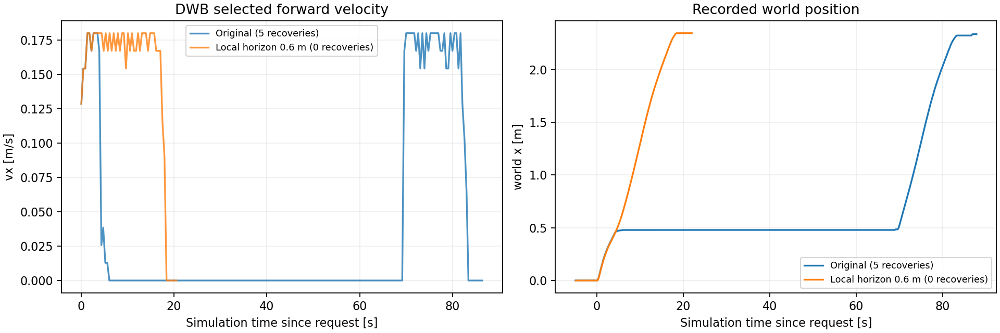

# M7 跟踪卡顿排查与修复

2026-11-23，本轮确认矩形障碍前的卡顿包含 DWB 评分局部最优。将 M7 的 `FollowPath.forward_prune_distance` 从未显式设置（Humble 默认 2.0 m）改为 0.6 m 后，自研 A* 两轮正式绕障均在约 21 秒到点、0 次恢复。原 M7 三个连续目标也重新成功、0 次恢复。

普通 0.8 m 窄通道仍未通过稳定跟踪检查：两轮都出现重规划起点受阻及恢复。因此这是**矩形绕障卡顿的已验证修复，不是全部场景问题清零**。原始数据和失败候选均已备份。

## 1. 证据：不是“没有任何可行速度”

沿用上轮 `box_astar_0` 的世界、地图、起终点及机器人，开启 DWB `publish_evaluation=true`，并关闭评分提前退出以记录完整分项。这些诊断开关没有改变评分权重；原问题再次复现为 87.36 秒、5 次恢复。

仿真时间 20.01 秒附近的记录：

| 候选 | vx m/s | 角速度 rad/s | GoalAlign 加权项 | GoalDist 加权项 | 总分 |
|---|---:|---:|---:|---:|---:|
| DWB 选中的低速原地调整 | 0 | -0.0316 | 6.0 | 14.5 | 20.5 |
| vx≥0.08 的最佳合法前进候选 | 0.09 | 0.60 | 5.8 | 15.0 | 20.8 |

这两个候选的其余分项均为 0，包括 BaseObstacle、PathAlign 和 PathDist。该时刻存在 314 条合法候选；“合法”仅指当时 DWB 评分检查接受，并不构成独立连续几何安全保证。DWB 以较低分为优，所以持续选择不前进的候选。20～60 秒内有 91 个记录样本的最佳 vx 小于 0.01 m/s。

完整记录在 `artifacts/m7_tracking/box_astar_0_baseline/diagnostic.json`。结合停滞时的真值位置、正的车体间距与较小定位误差，这些证据支持局部评分陷阱，而非简单解释成没有路径或所有前进速度都会碰撞。不能由单个分项为 0 推导“整个任务从未遇到障碍”。

## 2. 为什么改变局部路径范围

Humble DWB 从全局路径截取近处片段供评分器使用。`forward_prune_distance` 控制其前方截取范围；实际截取还受局部地图半边长限制。本项目局部地图宽 3 m，所以旧参数默认 2.0 m 时，该距离上限实际不超过约 1.5 m。GoalDist 使用传入局部路径上最后一个可用点传播栅格距离评分。

上述行为来自 [Nav2 1.1.20 DWB 实现](https://github.com/ros-navigation/navigation2/blob/1.1.20/nav2_dwb_controller/dwb_core/src/dwb_local_planner.cpp) 与 [GoalDist 实现](https://github.com/ros-navigation/navigation2/blob/1.1.20/nav2_dwb_controller/dwb_critics/src/goal_dist.cpp)。参数描述的是局部路径截取距离，不是雷达量程、全局规划范围或搜索深度，也没有把最终导航目标改近。

较远的局部目标与栅格折线路径在绕障弯处产生了不利的候选排序。缩短为 0.6 m，让局部评分围绕较近的路径片段计算；单参数对照和后续重复行驶支持此解释。它是当前场景的有效适配，不能据此认定所有路径都应使用 0.6 m。

## 3. 候选对照和最终修改

| 诊断配置 | 结果 | 耗时 | 恢复 | 是否采用 |
|---|---|---:|---:|---|
| 原参数 | 成功 | 87.36 s | 5 | 对照 |
| 仅 GoalAlign.scale 从 8 提到 32 | 失败 | 35.67 s | 15 | 否 |
| 原权重，仅 forward_prune_distance=0.6 | 成功 | 21.36 s | 0 | 是 |

提高 GoalAlign 权重的候选不仅未改善任务，几何采样还出现车体包络与障碍重叠，因此明确弃用。该候选只保留在独立诊断目录和复现实验脚本中，未写入当前导航配置。失败证据位于 `box_astar_0_goalalign32`，不能从交付数据中删掉后只展示成功试验。

最终生效的行为修改仅一项：

```yaml
controller_server:
  ros__parameters:
    FollowPath:
      forward_prune_distance: 0.6
```

写入 `nav2_astar_params.yaml` 和 `nav2_navfn_comparison.yaml`，使两种规划器对照继续使用一致的 DWB。GoalAlign.scale 仍为 8，正式配置仍开启原评分提前退出、没有开启评估发布。未修改 A* 内核、软权重、硬净间隙、地图半径、碰撞评分、速度、目标容差或进度检查阈值。未对全局路径做未经碰撞检查的平滑。M6 默认 nav2_params.yaml 不变。



## 4. 关闭诊断后的正式回归

以下运行关闭评分记录，使用原正常评分提前退出。数据独立保存在 `artifacts/m7_tracking_regression/`，不覆盖上轮未修复证据。

| 场景/规划器 | 耗时 s | 恢复 | 车体采样最小间距 m | 结论 |
|---|---:|---:|---:|---|
| 矩形绕障 A* 第 1 轮 | 21.43 | 0 | 0.381 | 稳定检查通过 |
| 矩形绕障 A* 第 2 轮 | 21.22 | 0 | 0.380 | 稳定检查通过 |
| 矩形绕障 NavFn | 21.43 | 0 | 0.407 | 稳定检查通过 |
| 宽通道 A* 第 1/2 轮 | 15.14 / 15.03 | 0 / 0 | 0.481 / 0.481 | 稳定检查通过 |
| 宽通道、A* 额外间隙开启 | 15.12 | 0 | 0.481 | 稳定检查通过 |
| 宽通道 NavFn | 15.53 | 0 | 0.450 | 稳定检查通过 |
| 窄通道 A* 第 1/2 轮 | 21.97 / 21.83 | 5 / 5 | 0.034 / 0.034 | 尚未稳定通过 |
| 窄通道、额外间隙开启 | 返回空路径并拒绝 | 0 | 未行驶 | 预规划拒绝后静止检查通过 |

9 次正式行驶均最终成功，采样重叠均为 0；其中 7 次满足成功、零恢复和零采样重叠的稳定检查，普通窄通道两次不满足。0.034 m 余量不能作为安全推荐。完整配对定位、几何和状态数据见 summary.json、measurements.md。

原 M7 旧地图的三个连续目标也已补测，中途不重新定位：

| 目标 | 耗时 s | 恢复 | 采样车体至测试箱最小距离 m |
|---|---:|---:|---:|
| (2,0,0) | 22.82 | 0 | 0.349 |
| (0,0,0) | 23.96 | 0 | 0.351 |
| (0,1.6,0) | 16.02 | 0 | 0.625 |

这轮第三目标的 world 末端到 map 目标差约 0.182 m，最大配对 AMCL/world 位置差约 0.129 m。差值比之前某轮小，但路径和激光观测也变化，不能宣称旧定位精度问题已修复。原任务数据为 `original_three_goal_results.json` 及其 summary。

## 5. 窄通道恢复是另一个原因

窄通道日志反复出现 `AStar: start blocked by cost or clearance`，而不是本次矩形场景的 DWB 评分停滞。0.8 m 宽度对半径 0.35 m 的模型仅有很小横向余量，定位和跟踪偏移可能使重规划起点进入受阻格。插件坚持拒绝该起点，没有照搬 NavFn 的起点清除行为。

因此没有通过清除起点、缩小机器人或关闭障碍检查让它强行通过。业务需要额外 0.15 m 净间隙时，应拒绝该通道；本轮拒绝实验仍返回 ABORTED、0 路径点，5 秒观察中平移为 0、非零命令为 0。此流程调用 ComputePathToPose 后不下发导航目标，不表示默认 NavigateToPose 行为树在失败后绝不会执行恢复动作。

普通窄通道若必须通行，需要继续专门验证横向跟踪误差、AMCL 偏移和任务入口策略。在此之前保留为未通过场景，不将恢复次数隐藏或改名为“正常动作”。

## 6. 复现与当前状态

诊断脚本 `tracking_diagnostic.py` 使用上轮保存的世界和地图：

```bash
source /opt/ros/humble/setup.bash
source ~/nav_ws/install/setup.bash
source ~/tf_fix_ws/install/setup.bash
python3 ~/nav_ws/src/my_robot_navigation/scripts/tracking_diagnostic.py box_astar_0 baseline
python3 ~/nav_ws/src/my_robot_navigation/scripts/tracking_diagnostic.py box_astar_0 prune06
```

两条分别独立启动仿真，完成后关闭；不要同时运行。它们以历史 case 的参数为基准，因此 baseline 会复现旧值，prune06 只覆盖前视参数。需要先保存 `artifacts/m7_physical/box_astar_0`。

正式回归使用当前 M7 配置：

```bash
python3 ~/nav_ws/src/my_robot_navigation/scripts/physical_scenario_suite.py --tracking-regression
python3 ~/nav_ws/src/my_robot_navigation/scripts/summarize_physical_scenarios.py \
  ~/nav_ws/artifacts/m7_tracking_regression
python3 ~/nav_ws/src/my_robot_navigation/scripts/render_tracking_diagnostic.py
```

复测会覆盖对应目录同名用例，应先备份；完整正式回归为 10 个用例（9 次导航和 1 次拒绝观察）。普通窄通道仍有恢复是已知结果，suite.json 的 passed 仅表示预期 action 状态，稳定性应查看 summary.json。

当前源码和证据已同步 Windows/Ubuntu；测试仿真已结束，没有保留自动行驶任务。下一步应专门处理窄通道策略与跟踪精度，而不是继续调整已解决的矩形场景评分陷阱。

后续已完成的宽度对照、失败位姿诊断和门控入口测试，见 [通道宽度与任务门控验收](ROS2-Nav2-M7通道宽度与任务门控验收.md)。
