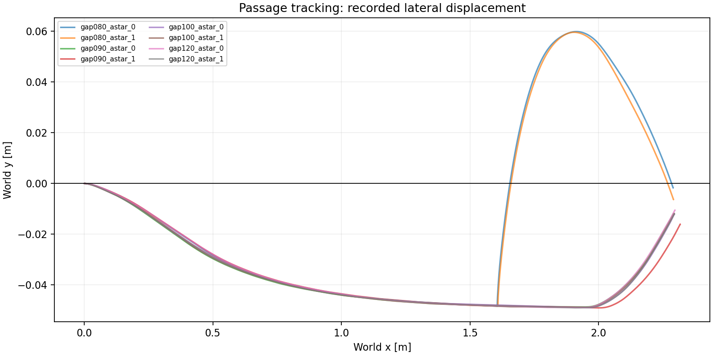

# M7 通道宽度、偏移来源与任务门控验收

2026-11-23，完成 8 次普通通道行驶和 8 次门控策略验证，并增加可执行任务入口。结论分为两层：普通 A* 在本场景 0.9/1.0/1.2 m 宽度各两轮稳定通过，0.8 m 不稳定；要求额外 0.15 m 净间隙时，1.2 m 仍可能运行中停止，1.4 m 两轮才完整到点。它们是离散实测点，不是对任意通道或真实机器人的宽度保证。

## 1. 0.8 m 问题由什么组成

本轮同时记录 `/ground_truth`、AMCL、轮式里程计、全局路径、`/cmd_vel`、规划器统计和规划失败后的全局 costmap 快照。失败时另取 TF 中 map→base_footprint 的位置，因此没有把旧 AMCL 消息直接当作当前机器人位置。

两轮首次起点受阻时的横向数据如下；通道中心线 y=0：

| 指标 | 第 1 轮 | 第 2 轮 |
|---|---:|---:|
| 附近规划折线 y | -0.025000 m | -0.025000 m |
| 最新真实 y | -0.048023 m | -0.048072 m |
| TF 估计 y | -0.050452 m | -0.050452 m |
| 估计与真实 y 差 | -0.002429 m | -0.002380 m |
| TF 起点格 | (94,62) | (94,62) |
| 起点格代价 | 253，不可通行 | 253，不可通行 |

首轮失败事件在仿真 15.462 s，地图采样为 15.464 s，所用真值时间为 15.452 s；第二轮的对应差也约 14 ms。这是近同时刻诊断，不应将毫米差值解释为经过严格标定的传感器精度。

在半径 0.35 m、宽 0.80 m 的圆形规划模型下，中心横向余量很小。格中心路径本身位于中心线下方约 25 mm，实际跟踪又偏离该折线约 23 mm；再加约 2.4 mm 的位置估计差，使估计位置跨过 y≈-0.05 的格边界，进入代价 253 的格。A* 随即以 `start blocked by cost or clearance` 拒绝重规划，默认行为树触发恢复。

因此，本场景并非“定位突然漂了几十厘米”，也不是一项单独的大转向误差。证据支持栅格位置偏置、离散跟踪误差和小位置估计差共同耗尽余量。不能据此认定所有窄通道失败都来自同一个原因。完整证据见 `artifacts/m7_width_study/failure_evidence.json`，原始快照在各用例 trial.json 的 failure_costmaps 中。

## 2. 普通配置的宽度对照

保持 DWB 前视范围 0.6 m、速度、半径、碰撞评分、AMCL 和普通 GridBased 规划器参数不变。仅改变 x=0.8～1.8 m 的开口宽度；每轮新启动仿真，从 (0,0,0) 前往 (2.4,0,0)。普通规划器的额外净间隙仍为 0。

| 宽度 | 两轮恢复次数 | 两轮最终状态 | 车体采样最小间距 | 稳定检查 |
|---|---|---|---|---|
| 0.80 m | 5 / 5 | 均成功到点 | 约 0.034 m | 不通过 |
| 0.90 m | 0 / 0 | 均成功到点 | 约 0.181 m | 通过 |
| 1.00 m | 0 / 0 | 均成功到点 | 约 0.231～0.232 m | 通过 |
| 1.20 m | 0 / 0 | 均成功到点 | 约 0.331 m | 通过 |

这里稳定检查为成功、零恢复、零采样几何重叠。最小间距覆盖整轮轨迹，0.8 m 的结果包含恢复动作，不能把不同宽度的最小间距直接当作直线行驶时的等比例几何关系。

0.9 m 是本轮测过的最小稳定宽度，不代表精确临界宽度；未测试 0.81～0.89 m，也未覆盖不同入口角度、地图偏移、速度或动态障碍。原始记录、几何、地图和表格保存在 `artifacts/m7_width_study/`。



## 3. 新任务入口：预检后再导航

新增 `safe_navigate.py` 和 `start_safe_navigation.sh`，供单任务调用者在已启动的 M7 仿真中使用：

1. 检查近期里程计、机器人静止状态和已有 NavigateToPose 任务，拒绝接管活跃任务。
2. 调用 ComputePathToPose，指定新别名 `ClearanceGate`。它使用自研 A*，额外净间隙为 0.15 m，普通 GridBased 不变。
3. 仅在规划成功且路径非空时，发送 NavigateToPose。
4. 该任务指定独立行为树 `behavior_trees/clearance_gate.xml`，后续重规划仍用 ClearanceGate；没有 Spin、BackUp 或恢复分支。运行中规划或跟踪失败时结束任务。

这样不会出现“初次用严格规划器预检，实际执行却改回普通规划器”的策略落差。新别名加入 nav2_astar_params.yaml，但原普通入口及 RViz Nav2 Goal 没有被全局拦截；需要使用新命令入口才能应用门控行为。

失败传播机制参考 [Nav2 1.1.20 PipelineSequence 实现](https://github.com/ros-navigation/navigation2/blob/1.1.20/nav2_behavior_tree/plugins/control/pipeline_sequence.cpp)：子节点失败会停止其余子节点并返回失败。实际停止效果仍以下面的运行观察为依据。

## 4. 门控策略验证

保持额外净间隙 0.15 m，不为窄通道缩小机器人或放宽约束，每个宽度独立测试两轮：

| 宽度 | 预检 | 实际导航结果 | 恢复次数 | 停止观察 |
|---|---|---|---:|---|
| 0.80 m | 两轮均拒绝 | 未发送导航目标 | 0 | 5 s 中位置不变，非零命令 0 |
| 1.00 m | 两轮均拒绝 | 未发送导航目标 | 0 | 5 s 中位置不变，非零命令 0 |
| 1.20 m | 两轮均通过 | 两轮运行中重规划受阻，ABORTED | 0 | 结束后留 1 s 稳定，再观察 4 s：位置不变、非零命令 0 |
| 1.40 m | 两轮均通过 | 两轮成功到点，约 16.5～16.8 s（含入口预检） | 0 | 全程采样未重叠，最小车体间距约 0.431～0.432 m |

1.2 m 的失败不能算作导航成功。它验证了运行中拒绝后的停止行为；summary 中 mission_succeeded/stable_traversal 为 false。suite.json 中 validation_passed 为 true 仅表示符合“运行中失败后保持停止”的本轮预设检查，不表示通过通道。

初次预检只说明当前位姿到目标存在一条符合地图约束的路径，不保证实际执行始终成功。硬约束采用保守整格筛选，加上跟踪和定位偏移，1.2 m 场景可能从可行起点变成不可行起点。这也是不能仅用理论宽度或一次预规划判断通行的原因。

这一入口没有恢复旋转，也不是急停装置或多控制源仲裁器。它不能拦截其他节点直接发布的速度，不能保证重规划检查之间始终满足全部净间隙。当前验证范围为单调用者、静止开始、无其他遥控速度源的仿真。运行中停止数据是稳定等待后的位置观察，不是制动距离或即时停止能力的认证。

## 5. 命令入口验收与使用

通过安装后的命令测试了窄通道拒绝、宽通道到点和已有活跃任务时拒绝接管。返回约定为：

- 0：导航成功。
- 2：预检未通过，未发送导航目标。
- 1：执行未成功或其他异常；具体原因查看 JSON/错误输出。

在 Ubuntu 先用 M7 A* 入口启动单套仿真，再开一个终端：

```bash
bash ~/nav_ws/src/my_robot_navigation/scripts/start_safe_navigation.sh 2.4 0 0
```

三个参数依次是 map 坐标 x、y 和目标朝向（弧度）。包装脚本自动加载 Humble、nav_ws、tf_fix_ws 和 domain25；不会启动另一套仿真。需要规划器服务器已经加载当前 M7 配置中的 ClearanceGate。

手动查看门控验证的 1.4 m 场景：

```bash
case_dir=$HOME/nav_ws/artifacts/m7_gate_validation/gap140_gate_0
bash ~/nav_ws/src/my_robot_navigation/scripts/start_astar_navigation.sh \
  gui:=true rviz:=true world_file:=$case_dir/world.sdf \
  map:=$case_dir/map.yaml params_file:=$case_dir/params.yaml
```

然后在第二个终端执行上述 start_safe_navigation.sh。不要通过 RViz 的 Nav2 Goal 按钮替代该命令来验证门控，因为按钮使用的默认任务入口不同。

## 6. 复现数据和后续边界

正式记录位于：

- `artifacts/m7_width_study/`：8 次普通宽度测试。
- `artifacts/m7_gate_validation/`：8 次门控验证，含运行中中止。
- `artifacts/m7_gate_entry/`：安装命令入口和活跃任务拒绝检查。
- `artifacts/m7_gate_study/`：早期 1.2 m 预检通过但执行失败的探索记录，未覆盖或删除。

脚本位于 my_robot_navigation/scripts：physical_scenario_suite.py 的 `--width-study`、`--gate-validation` 分别复现两组正式试验，analyze_passage_study.py 汇总，test_gate_entry.py 验证命令入口。重跑会覆盖同名用例，应先备份。

当前未修改 A* 内核、DWB 参数或 M6 默认配置；仅增加记录、实验和独立门控入口。所有正式轨迹的车体采样重叠为 0，测量沿用已有保守车体投影，不是连续碰撞证明。

下一步若业务必须通过 0.8 m 通道，应另做窄通道精细跟踪与定位鲁棒性专项；当前不建议强行放宽约束。若业务优先保留 0.15 m 额外净间隙，可使用门控入口，并把本轮 1.4 m 通行作为起步验证场景。原先约 0.27 m 的旧地图连续任务误差仍是独立问题，本轮没有宣布其修复。
