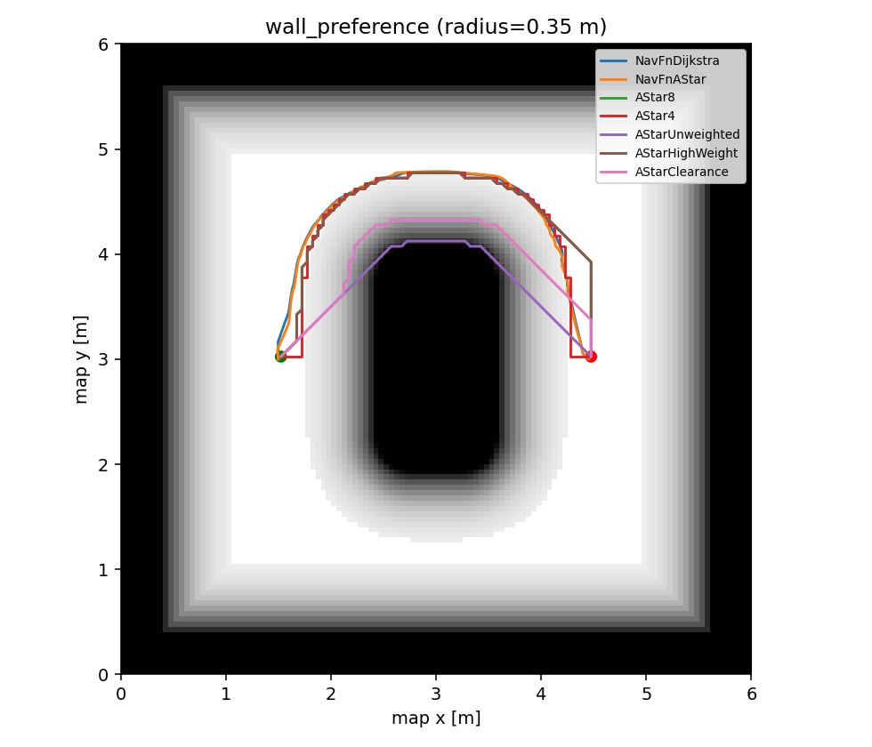

# M7 针对性场景对照

2026-11-23，在 Ubuntu 使用真实 Nav2 planner_server 插件完成四种合成场景实验，不运行 Gazebo、不发送速度命令。结果已备份到 `artifacts/m7_targeted/`，脚本为 `src/my_robot_navigation/scripts/targeted_planner_trials.py`。

## 方法

使用独立 ROS_DOMAIN_ID=28、静态地图和膨胀层、显式起终点、0.05 m 分辨率的 120×120 地图。比较 NavFn Dijkstra、NavFn A*、自研 A* 的 8/4 邻接、权重 0/2/8、权重 0 加额外净间隙 0.15 m，共七种配置。每场景每配置预热一次，记录三次，共 84 次正式结果；另有每场景一次起点归一化探测。

NavFn 会清除起点代价，膨胀层可能恢复其代价。调试时哈希检查捕获了这一干扰，最终将贴墙实验起点放在零代价格，并使窄通道的膨胀半径取 0.35 m。启动后等待地图稳定；每次请求后核验原始代价地图哈希相同。脚本还预先探测起点清除，只允许起点变成 0 的变化，随后冻结比较基准；各场景原始网格、哈希及归一化格列表保存在 costmap.json。不同场景的膨胀半径不同，因此仅在同一场景内进行规划器比较。

各场景结果中的 4 为 SUCCEEDED，6 为 ABORTED。拒绝不可达路线或违反额外间隙要求是预期行为，不是程序故障。

## 结果

| 场景 | NavFn 两模式 | 自研普通配置 | 自研额外间隙 0.15 m |
|---|---|---|---|
| 两自由象限仅在角点相接 | 均拒绝 | 均拒绝 | 拒绝 |
| 0.80 m 直通道 | 均成功 | 均成功 | 拒绝 |
| 1.50 m 直通道 | 均成功 | 均成功 | 成功 |
| 矩形障碍绕行 | 均成功 | 均成功 | 成功 |

对角场景使用半径 0、无膨胀，仅用于点机器人栅格拓扑检查，不代表实体机器人实验。两个被占据象限阻止直接对角穿过，自由空间只在一个角点相接。**本场景没有复现 NavFn 穿角，因此不能宣称 NavFn 必然会穿过对角夹缝。** 自研禁止切角的依据还包括已有内核测试中的正交邻格检查。

两种通道均采用机器人半径 0.35 m。0.80 m 通道在中心附近只有约 0.025 m 的圆形半径余量（中心采样距离约 0.375 m，受选取格中心影响），不满足额外 0.15 m 的要求。自研间隙模式因此拒绝；1.50 m 通道中心采样距离约 0.725 m，可以通过。窄通道膨胀半径为 0.35 m，宽通道为 0.65 m，未通过关闭基础致命/内切代价检查获得结果。

矩形障碍场景使用半径 0.35 m、膨胀半径 1.0 m；起点 (1.525,3.025)，终点 (4.475,3.025)。路径中心至所有致命障碍格面积的最小采样距离如下：

| 配置 | 中心采样距离 m |
|---|---:|
| NavFn Dijkstra | 0.965 |
| NavFn A* | 0.946 |
| 自研 A* 权重 0 | 0.334 |
| 自研 A* 权重 2 | 0.973 |
| 自研 A* 权重 8 | 0.973 |
| 自研 A* 权重 0、额外间隙 0.15 m | 0.571 |

这说明软代价能改变离障偏好，但增加权重不会必然继续增大最小距离。额外净间隙模式在不依赖软惩罚的情况下约束离障距离；其保守筛格可能使通道不可通行。

注意：中心距离不是车体净间隙，也不是连续安全证明。权重 0 的约 0.334 m 小于 0.35 m 半径，表明仅依赖离散膨胀代价和可通行格，不能承诺连续圆形足迹始终具有半径余量；不能将该配置作为安全推荐。额外间隙模式具有独立的保守整格约束，默认普通 A* 不能借用该模式的保证。



距离计算沿返回折线按不超过 0.0025 m 间隔采样，对已知致命障碍格的矩形面积计算欧氏距离。成功路径的实际行驶、动态障碍和定位误差未在本实验验证。三次重复用于检查行为稳定性，不构成广泛统计性能结论。

## 复现

```bash
source /opt/ros/humble/setup.bash
source ~/nav_ws/install/setup.bash
source ~/tf_fix_ws/install/setup.bash
python3 ~/nav_ws/src/my_robot_navigation/scripts/targeted_planner_trials.py
```

脚本生成地图、参数、日志、路径图和 results.json；将覆盖 `~/nav_ws/artifacts/m7_targeted` 同名结果，复测前先备份旧数据。需要 numpy、yaml、matplotlib（当前 Ubuntu 已具备）。退出时停止本轮启动的节点。现有 domain25 小车导航配置和 M6 基线不变。

## 对项目目标的含义

已经得到两项直接证据：额外间隙阈值改变窄通道可达性；软权重改变同图路线偏好。对角夹缝实验验证本场景的拒绝行为，但没有证明相对 NavFn 的优势。自研规划器目前的价值是能够独立控制并解释这些规则，而非宣称所有场景更快、更短或更安全。
