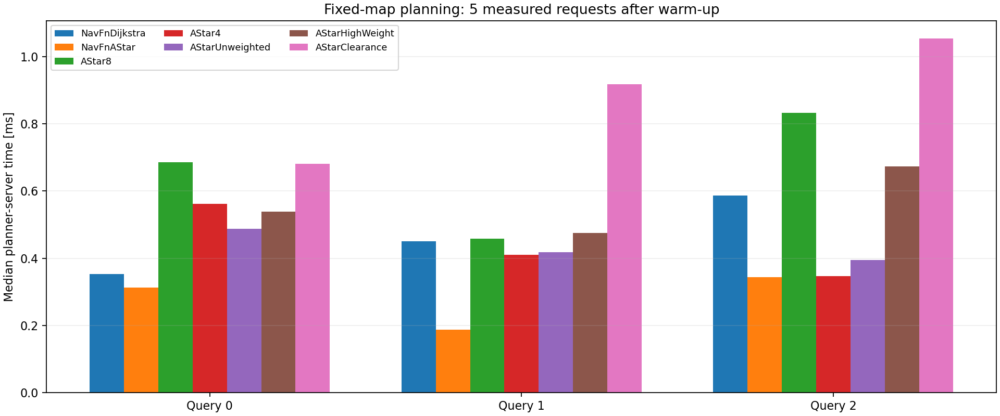
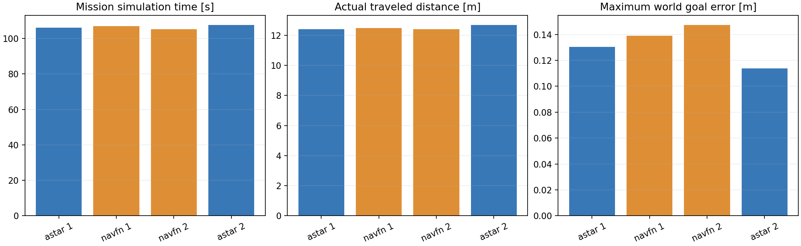

# M8 评测与项目交付

M8 按原定范围执行：统一评测成功率、规划耗时、路径质量，整理演示与复现资料，并打包交付。动态障碍测试是可选扩展，不是本阶段完成条件。

## 评测口径

| 证据 | 样本与口径 | 用途 |
|---|---|---|
| A* 内核测试 | 14 个已归档 gtest | 搜索、切角、代价和约束正确性 |
| 固定地图规划 | 3 组起终点 × 7 配置 × 5 次测量，共 105 次；每组配置另有一次不计入的预热 | 规划器服务端耗时中位数、返回折线长度、采样中心离障距离 |
| 非法目标 | 2 次，障碍内与越界，均拒绝 | 不返回伪成功路径 |
| 校准配置闭环 | A*、NavFn 各 2 次新仿真，每轮 4 个连续目标，共 16 次 | 到点状态、仿真任务时间、真值行驶长度和真实到点误差 |
| 生产门控回归 | 两轮，各 5 个导航目标和 1 个预期预检拒绝 | 连续接单、拒绝后继续执行 |
| GUI 演示 | 绕箱、返回，共 2 个目标 | 用户可视确认与运动结果 |

统一脚本为 `tools/evaluate_project.py`，输入文件哈希保存在 `evaluation.json`。JSON、CSV、Markdown 可在 Windows/Ubuntu 重新生成；图表由 Ubuntu matplotlib 生成。归档重算不等于重新采集实验。

这些测试有不同地图和配置，不能汇成一个“全项目成功率”。闭环同轮多个目标相关，不能把 16 个目标当作 16 次独立随机试验。规划器 CPU/服务端耗时、action 往返、仿真任务时间与现实耗时也不能混用。

## 结果摘要

固定地图：105/105 个测量请求成功，两个非法目标按预期拒绝；每次请求检查原始代价地图哈希未变。名义 AStar8 与 NavFnDijkstra 的三个查询规划耗时中位数分别为：

| 查询 | AStar8 / ms | NavFnDijkstra / ms |
|---|---:|---:|
| 0 | 0.686 | 0.353 |
| 1 | 0.458 | 0.451 |
| 2 | 0.833 | 0.586 |

本组测量没有证明自研 A* 更快。其价值在于可独立控制 4/8 连通、禁止切角规则、代价权重和额外净间距。所有七种配置、折线长度和间距数据见 [统一结果表](../artifacts/m8/evaluation/comparison.md)。NavFn 也能通过代价地图膨胀影响离障偏好，不能将自研意义表述为 NavFn 完全不具备离障调节能力。

校准闭环：A* 8/8、NavFn 8/8，恢复均为零。四轮总仿真任务时间约 105.08～107.58 秒，实际行驶 12.39～12.69 m；两者接近，没有显著优劣结论。最大真实到点误差约 0.114～0.147 m，不能宣称精确停靠。

生产门控：导航 10/10 成功，预期拒绝 2/2 正确，均零恢复。拒绝没有发送导航运动目标，不计为导航失败。GUI 两目标成功，用户确认 Gazebo/RViz 正常显示。演示资料为启动与操作说明、轨迹图、动作结果记录；本次没有录制演示视频。

## 配置与依赖交付

默认 M6 NavFn+DWB 配置保留。M7 使用自研 A*、Rotation Shim+DWB；仿真校准入口另设有效轮距比例 0.995，AMCL alpha1～alpha4=0.001。不能直接复制这些参数到 BCR Bot、TurtleBot 4 或实物。

实际参考环境：Ubuntu 22.04.5、Humble、Gazebo 6.18.0；Nav2 1.1.20、ros_gz_bridge 0.244.27、Cyclone DDS RMW 1.3.6，实际包构建版本见支持目录。软件包以后可能变化，现有环境记录不是跨版本保证。

当前运行依赖 `~/tf_fix_ws` 中的 tf2 覆盖库，仅编译 tf2 包。第三方上游提交、完整已打补丁源码和补丁单独交付，保留 BSD 许可证，详见 [第三方说明](../THIRD_PARTY_NOTICES.md)。该补丁的全面并发语义验证仍是边界。

## 交付内容与复现入口

- 根目录 `README.md`：新环境编译、手动演示、停止、重新生成评测与打包。
- `src/`：四个 ROS 包源码、地图、配置、行为树和测试脚本。
- `docs/`：M1～M8 与问题排查说明。
- `artifacts/`：各阶段原始结果、历史失败记录、修复前后证据和图表。
- `tools/`：统一评测、打包和逐文件哈希验证工具。
- `artifacts/m8/support/`：依赖版本、tf2 来源与补丁源码。
- `artifacts/m8/delivery/`：交付 ZIP 和独立 SHA-256 文件；ZIP 内含逐文件哈希清单。

历史失败实验保留用于说明修复过程，不能视为当前配置的重复测试，也不应只挑选历史成功结果合并指标。M6 的 RPP/DWB 对比仍以 M6 文档的原始条件为准，不并入 M7 规划器对照。

## 交付验收记录

| 检查 | 结果与证据 |
|---|---|
| Windows / Ubuntu 归档重算 | 均通过统一脚本断言，输出 105 次规划、16 次闭环、门控与 GUI 的分类指标 |
| 图表检查 | 固定地图耗时、闭环指标两张图已检查标签和版面 |
| ZIP 完整性 | 文件集合、CRC 和逐文件 SHA-256 校验；包外另附 ZIP SHA-256 |
| 独立目录构建 | 在同一 Ubuntu 的 artifacts/m8/release_check 解压源码，四包编译成功；日志 release_build.log |
| 独立构建测试 | 14 个 gtest 用例通过；colcon 汇总 15 条测试记录（包含外层记录），0 错误、0 失败；日志 release_test.log 和重建 XML |
| 独立构建运行 | domain29，时钟推进、433 条激光消息、四个节点 active；从原点绕箱至 (0,2.6)，状态 4、零恢复，见 verification/smoke_final.json |
| 实际库路径 | 规划器加载独立构建的 libmy_astar_planner.so，AMCL 和规划器均加载 tf_fix_ws 的 libtf2.so |
| 退出清理 | 运行检查关闭其启动的进程组，检查后没有残留 Gazebo/RViz/项目启动进程 |

编译仍有 tf2 与系统库运行搜索路径约束环提示。实际进程映射确认本次按预期加载；启动时仍应加载 README 规定的覆盖环境。

本次证明同一虚拟机上交付源码能独立编译并运行，不等于全新虚拟机从零安装依赖已经验收。已打补丁的 tf2 源码随包交付，本轮沿用现有编译覆盖库，未再次全面验证 tf2 并发语义。

## 验收边界

本阶段针对已有证据的评测和当前环境的可复现交付；独立解压、编译、测试和启动检查的实际结果写入 `artifacts/m8/verification/`。没有进行全新 Ubuntu 虚拟机的完整安装验收。动态障碍、真实硬件、复杂仓库、长期稳定性与统计优势均不在本次结论中。
