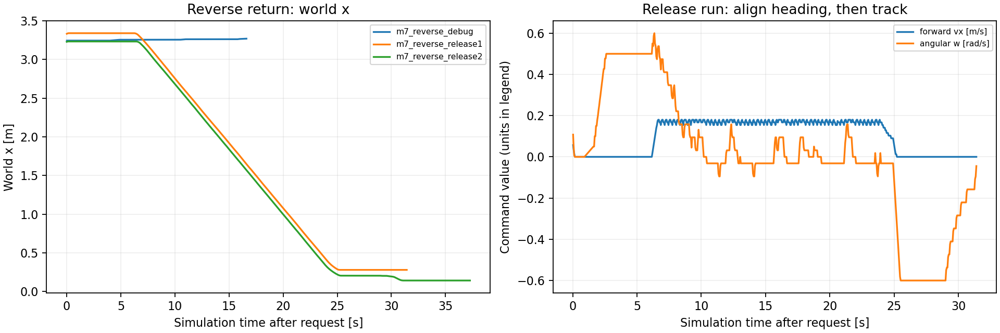

# M7 反向通行卡顿修复与连续验收

2026-11-24，本次复现的反向返回卡顿已改善并通过重复验证。正式配置下，两轮完整六步序列的 10 次导航均成功，2 次窄通道请求均在预检阶段拒绝，恢复次数全部为 0。旧地图 A*、NavFn 三目标任务也各复测一次，均成功、0 次恢复。

本结论限于当前静态场景；普通 0.8 m 通道、累计定位精度、动态障碍和实物仍不属于已解决事项。

## 1. 问题与诊断证据

原配置在第四步“右侧房间返回原点”再次失败：约 16.65 秒后 Failed to make progress，ABORTED、0 次恢复。机器人停在约 (3.16,-0.31)，仍在右侧房间。失败记录保存在 artifacts/m7_reverse_debug，没有覆盖。

仿真 87.868 秒的 DWB 评分中，最优原地调整 vx=0、角速度约 0.0316 rad/s，总分 10.4；vx≥0.08 的最佳合法前进候选 vx=0.09、角速度约 0.411，总分 14.4。两者 BaseObstacle 均为 0，主要差异来自路径/目标对齐与距离项。低分优先导致持续选择低速调整。

结合任务切换时从朝向右侧改为朝向左侧的几何，这支持大朝向变化时的局部评分陷阱，不支持“没有全局路径”的解释。原始 scores.json 保留完整分项，原先 m7_continuous 的失败记录也保留。

## 2. 正式修改

M7 FollowPath 使用已安装的 Rotation Shim，内部仍是原 DWB。先尝试带碰撞检查的路径朝向对准，再交给 DWB 跟踪，参考 [Nav2 1.1.20 实现](https://github.com/ros-navigation/navigation2/blob/1.1.20/nav2_rotation_shim_controller/src/nav2_rotation_shim_controller.cpp)。返回时先掉头，再以前进方式穿过通道，min_vel_x 仍为 0。

```yaml
FollowPath:
  plugin: nav2_rotation_shim_controller::RotationShimController
  primary_controller: dwb_core::DWBLocalPlanner
  angular_dist_threshold: 0.785
  forward_sampling_distance: 0.5
  rotate_to_heading_angular_vel: 0.5
  max_angular_accel: 1.0
  simulate_ahead_time: 1.0
```

nav2_astar_params.yaml 与 nav2_navfn_comparison.yaml 同步采用此组合，新增运行依赖 nav2_rotation_shim_controller。其余 DWB 参数（包括前视 0.6 m）、A* 内核、额外净间隙 0.15 m、速度、目标容差、进度与碰撞检查均不变。M6 默认 nav2_params.yaml 不变。

这是正常转向衔接，不是失败后的恢复。门控行为树仍没有 Spin、BackUp、RecoveryNode；失败仍结束任务。首轮正式反向起步的 6 秒中，107 条速度样本有 84 条属于低线速度、明显角速度的原地转向。整轮最大命令为 0.18 m/s、0.6 rad/s，没有提高原上限。

## 3. 重复验收

诊断模式成功后关闭评分发布、恢复正常评分提前退出，独立启动两轮正式仿真。各轮内部不重启仿真、不重置定位。

| 任务 | 第 1 轮 s | 第 2 轮 s | 结果 | 恢复 |
|---|---:|---:|---|---:|
| 绕障到 (0,2.6,0) | 27.48 | 27.14 | 均成功 | 0 |
| 返回 (0,0,0) | 25.83 | 27.07 | 均成功 | 0 |
| 正向到 (3.3,0,0) | 21.25 | 22.05 | 均成功 | 0 |
| 反向返回 (0,0,0) | 31.57 | 37.83 | 均成功 | 0 |
| 请求穿窄通道到 (-3.3,0,0) | 1.51 | 1.51 | 预检拒绝，未发送导航目标 | 0 |
| 拒绝后到 (0,-0.8,0) | 13.96 | 13.17 | 均成功 | 0 |

不能把“原配置 16 秒失败、新配置 32～38 秒成功”描述为耗时加速；本次修复的是任务完成能力，样本也不足以作一般性能排名。



两轮全序列按半径 0.35 m 保守圆形计算，最小世界坐标采样障碍余量约 0.145 m、0.216 m，圆形采样重叠均为 0。0.15 m 是规划地图中的路径约束，不是世界真值的逐时刻保证；第一轮余量略低于此值，说明实际定位/跟踪误差仍影响间隙。这也不是连续碰撞证明。

反向返回结束时 world 位置距目标约 0.283 m、0.153 m。本轮没有同步采集完整 AMCL 序列拆分此误差，不能将到点成功当作精确定位已解决。旧地图的两组三目标结果见 m7_reverse_summary 中的 astar/navfn_shim_regression.json 及 summary。

## 4. 复现、演示与数据

```bash
source /opt/ros/humble/setup.bash
source ~/nav_ws/install/setup.bash
source ~/tf_fix_ws/install/setup.bash
python3 ~/nav_ws/src/my_robot_navigation/scripts/continuous_acceptance.py --reverse --plain
python3 ~/nav_ws/src/my_robot_navigation/scripts/continuous_acceptance.py --reverse --plain --second
python3 ~/nav_ws/src/my_robot_navigation/scripts/summarize_reverse.py
```

分别输出 m7_reverse_release1、m7_reverse_release2；重复运行会覆盖同名数据，先备份。用 `--reverse --baseline` 可读取保存的 m7_reverse_debug/params.yaml 重放原 DWB 配置，预计会在第四步失败并退出。普通 `--reverse` 使用当前配置并写入 m7_reverse_current，避免覆盖原失败。

Ubuntu 桌面终端运行 `bash ~/nav_ws/src/my_robot_navigation/scripts/start_m7_demo.sh`；另一个终端依次用 start_safe_navigation.sh 发送表中六个目标，每个结束后再发下一个。第五个退出码 2 为预期拒绝，不要用 && 将六条命令串联。需要 Gazebo GUI 可在演示启动命令后加 gui:=true；本轮验证采用无 GUI，未做本轮图形显示验收。

失败、诊断候选、两轮正式结果分别在 artifacts/m7_reverse_debug、m7_reverse_shim、m7_reverse_release1/2；汇总、旧地图回归和修复前配置位于 artifacts/m7_reverse_summary。源码、文档与证据已备份，结束后无自动导航任务。

当前关键连续流程通过。后续应优先评估累计定位误差，并保留已有窄通道拒绝策略，而不是把本轮结果推广成全场景精确导航保证。
