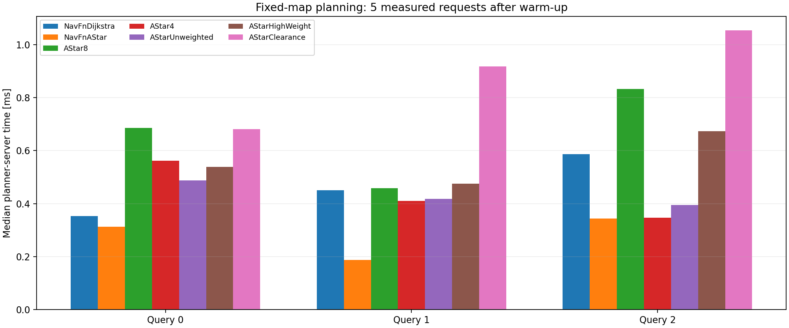
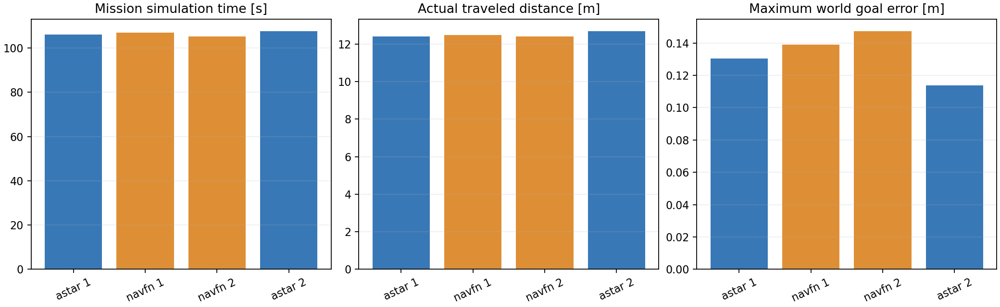

# 评测说明

本项目分别记录固定地图规划、闭环导航、任务门控和可视演示。它们使用不同条件，指标分开统计，不汇成单一的“项目成功率”。

## 实验类型与指标

| 实验 | 条件与样本 | 指标 |
|---|---|---|
| 搜索内核 | 14 个单元测试 | 搜索代价、切角规则、线段和距离场约束 |
| 固定地图 | 3 组起终点、7 配置，各预热 1 次后测量 5 次，共 105 次 | 服务端规划耗时中位数、返回折线长度、采样路径中心离障距离 |
| 非法目标 | 障碍内与越界各 1 次 | 拒绝状态与空路径 |
| 闭环导航 | A* 与 NavFn 各两轮新仿真，每轮 4 个连续目标 | 到点状态、恢复次数、仿真任务时间、真值行驶长度和真实到点误差 |
| 任务门控 | 两轮各 5 个导航目标、1 个预期预检拒绝 | 导航结果、拒绝正确性和拒绝后接单 |
| 可视演示 | 绕箱、返回两个目标 | GUI 显示确认与动作结果 |

原始数据保存在 `artifacts/`。目录中的阶段编号用于标识历史采集批次，不是使用项目必须了解的流程。重算结果保存于 [results/evaluation](../results/evaluation/)。

## 固定地图规划

七种配置为 NavFn Dijkstra、NavFn A*、自研 A* 的 8/4 连通、零权重、高权重和额外净间距配置。测试对每个请求核对原始代价地图哈希一致，测量结果为 105/105 次成功，两个非法目标均按预期拒绝。

名义 AStar8 与 NavFn Dijkstra 的耗时中位数如下：

| 查询 | AStar8 / ms | NavFn Dijkstra / ms |
|---|---:|---:|
| 0 | 0.686 | 0.353 |
| 1 | 0.458 | 0.451 |
| 2 | 0.833 | 0.586 |



本组数据没有证明自研规划器更快。所有配置的折线长度和采样中心距离见 [完整结果表](../results/evaluation/comparison.md)。规划器服务端耗时、action 往返和导航任务时间属于不同指标。

## 闭环导航

解析地图分辨率为 0.05 m，内侧边界为 ±4 m，包含箱体与两侧通道。目标依次为 (0,2.6)、(0,0)、(3.3,0)、(0,0)，轮内不重置定位。测试按 A* → NavFn → NavFn → A* 顺序执行。

地图、模型、定位、Rotation Shim+DWB、目标容差和无恢复行为树保持相同。两种算法均使用基础代价地图约束，不叠加生产门控的额外间距。测试专用配置中的 `ClearanceGate` 只是行为树所需别名，不可作为生产间距策略直接复用。

| 配置 / 轮次 | 成功 | 恢复 | 仿真任务时间 / s | 实际行驶 / m | 最大真实到点误差 / m | 最小采样圆间距 / m |
|---|---:|---:|---:|---:|---:|---:|
| A* / 1 | 4/4 | 0 | 106.06 | 12.39 | 0.130 | 0.259 |
| NavFn / 1 | 4/4 | 0 | 106.82 | 12.49 | 0.139 | 0.268 |
| NavFn / 2 | 4/4 | 0 | 105.08 | 12.41 | 0.147 | 0.237 |
| A* / 2 | 4/4 | 0 | 107.58 | 12.69 | 0.114 | 0.252 |



两者在该场景中表现接近。每种算法只有两次新仿真，同轮目标也相关，不能据此证明统计优势。运行中的代价地图随传感器观测更新，没有冻结每一帧。

## 门控与到点误差

两轮生产门控回归中，10 个导航目标成功，两个不满足额外间距要求的目标均在发出导航目标前被拒绝，恢复次数为零。预期预检拒绝不计为导航失败。

真实到点误差同时受定位误差和导航容差影响。配置中的 xy 目标容差为 0.12 m，不代表世界坐标误差保证小于这一值。实际障碍间距使用半径 0.35 m 的圆和离散真值采样估计，不是接触传感器结果或连续碰撞证明。

## 重新生成结果

安装 matplotlib 的环境中运行：

```bash
cd ~/nav_ws
python3 tools/evaluate_project.py
```

只生成表格和 JSON：

```bash
python3 tools/evaluate_project.py --no-plots
```

Windows 也可使用 `python tools/evaluate_project.py --no-plots`。该命令读取归档、验证关键断言并重新计算指标，不重新采集规划或导航数据。输出包括 `evaluation.json`、三个 CSV、结果表和图表；JSON 记录输入证据的 SHA-256。

需要重新运行机器人实验时，先结束已有仿真并归档旧输出。固定地图与闭环脚本位于 `src/my_robot_navigation/scripts/`，部分脚本保留历史输出目录或拒绝覆盖已有记录。详细采集方法见 [开发记录索引](archive/README.md)。

## 打包与验证

```bash
python3 tools/build_delivery.py
python3 tools/verify_delivery.py dist/ros2-nav2-diffbot.zip
```

打包结果包含源码、主题文档、开发记录、环境支持文件及实验数据，ZIP 内含逐文件哈希清单，ZIP 外另附 SHA-256。`verify_delivery.py` 可通过 `--extract-to 新目录` 校验并解压。

当前运行验证覆盖同一虚拟机中的独立源码构建；未覆盖全新系统安装、真实硬件、动态障碍或精确停靠。
